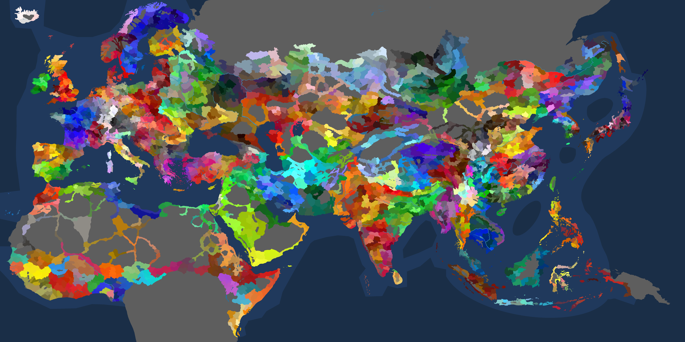
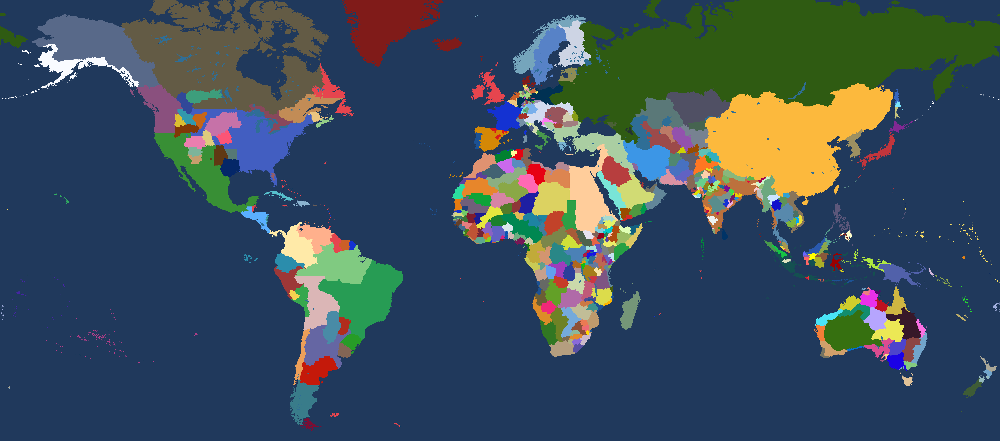

# 地图编辑器（CK3 / EU4 / HOI4 / Victoria 3 / EU5）

> **当前版本：v1.9（2026-10-17）**

> 作者：**永夜廿九**（B 站同名）· 代码 MIT · [Releases](https://github.com/Nianjiujiang/pdx-map-editor/releases)

一个在浏览器里改游戏地图的工具：**涂色、改色、改名、换色块边界、导出图片**。

想拿游戏的省份图做视频封面、做架空世界的版图、给自己写战报配张地图，或者单纯想看看 1066 年欧亚大陆到底谁占着哪块地 —— 以前要开游戏、截图、再进 PS 一块块描。这个工具把那些图直接铺进浏览器里：点哪块改哪块，改了能导出成 PNG，也能存成文件下次接着改。

**不用装、不用登录、不联网、免费。** 拿到 HTML 文件双击就能跑。

## 现在收录了这些

| 游戏 | 地图 | 剧本层 |
|---|---|---|
| 十字军之王 3 | CK3 | 1066 |
| 欧陆风云 4 | EU4 | 1444 / 1618 / 1789 |
| 钢铁雄心 4 | HOI4 · HOI4 修改边界 | 1936 / 1939 |
| 维多利亚 3 | Victoria 3 | 1836 |
| 欧陆风云 5 | EU5 · EU5 原尺寸 | 1337 |

> CK2 模式正在内测中，暂不公开下载。
> 「EU5 原尺寸」是同一张图的高分辨率版，地块更细、开图慢几秒。






这几张都是游戏自己带的图。**修改边界**那张是地图作者改过省份划分的版本；创意工坊 mod 里另做一套地图的（KR、PB、TNO 那类），见下面「关于 mod 地图」。

## 怎么开始

从 v1.9 起，编辑器和地图**分开下的**：

**① 编辑器本体（电脑版）** —— `pdx-map-editor.html`，**不到 1 MB**，双击就能跑（Chrome / Edge / Firefox 都行）。
里面只有代码，一张地图都没带。

**手机 / 平板版** —— 同一个 Release 里还有 `pdx-map-editor-mobile.html`，**不到 1 MB**。手机浏览器打开就能用，触屏涂色、双指缩放，界面按手机重新排过。

**② 要哪张地图下哪个包** —— [Releases](https://github.com/Nianjiujiang/pdx-map-editor/releases) 附件里那 7 个 `.pdxmap`，
**选图那一页点「＋ 导入地图包…」，导进去就能用**：

| 地图包 | 大小 |
|---|---|
| CK3 原版 | 2.4 MB |
| EU4 原版 | 0.8 MB |
| HOI4 原版 | 1.5 MB |
| HOI4 修改边界 | 1.5 MB |
| VIC3 原版 | 3.7 MB |
| EU5 原版 | 4.2 MB |
| EU5 原尺寸 | 12.5 MB |

不想要哪个就不下，别人照样能跑 —— 以前是所有地图烘在一起、人人下 35 MB，现在按需来。

### 想要「一个文件全都有」

v1.9 的 Release 里**不再放** 35 MB 的全量版 —— 编辑器只带代码，地图按包下，这是有意的。
真要一个文件全带走，本机跑 `python build_standalone.py --all-maps` 自己烘一份（约 35 MB，地图全在里面，双击即用），见 [`docs/构建与开发说明.md`](docs/构建与开发说明.md)。

### 想自己改游戏之外的地图？

`.pdxmap` 是公开格式。地图作者可以用 [`pack_map.py`](pack_map.py) 把一份解析好的数据打成一个包，玩家直接导进来就能画 —— 不用等编辑器专门出个「适配某某 mod」的版本：

```bash
python pack_map.py data_kr --id kr-1936 --label "KR 1936" --author 你的名字 --out kr-1936.pdxmap
```

格式和打包说明见 [`packs/README.md`](packs/README.md)。

### 先说三件容易踩的事

- **导入的地图存在浏览器里，不在 HTML 文件旁边。** 刷新、关掉再开都还在；换电脑、清了浏览器数据就得重导一次。所以包的原文件请自己留好 —— 每张卡的右下角也有「导出」能把这份重新打回一个包。
- **浏览器不给存的时候（隐私模式、禁用了本地数据）**，那一页会明说你「刷新就没了」，那张图只在这一趟里能用。
- **涂色不会自动保存，刷新就清空。** 这是故意的：免得你以为存在了。真有改动又没导出过，关页面时浏览器会拦你一下问一句。想留着就点「文件 ▾ → 导出涂色」。

### 关于 mod 地图

TNO、KR 这些 mod 的地图**我没拿到地图作者的授权，不能替你打包发出来** —— Releases 里那些包，装的都只是游戏自带的那几张图。这不是技术问题，是别人的图得别人点头。

既然包是公开格式，路就通了：地图作者用 `pack_map.py` 打一个 `.pdxmap` 发出来，你在导入那一页导进去就能用。作者愿意发就能用，编辑器本体不必为某一个 mod 出专门版本。

## 三步上手

**① 选图。** 打开就是选图页。导入的地图都在这一页，点卡片进去；卡多了就在**同一列列表里滚动**（不再分两列）。

**② 认颜色。** 想用地图上原有的某个颜色，**右键点那块地**就是吸管（左栏工具栏里也有「吸管」）。颜色会落进左栏的「当前颜色」和「最近使用」，点一下就能再用。想要个全新的颜色，直接改 HEX 或 RGB。

**③ 涂。** 按 `E` 是涂抹（按住拖能刷一片），按 `F` 是填色（点一下动一次，手抖了也不怕划过去）。刷错了按 `R` 橡皮，或者 `Ctrl+Z`。

改完想留着，点「**文件 ▾ → 导出涂色**」，存成一个 JSON，下次「导入」接着改。

第一次用还可以点顶栏的「**教程**」，它会在界面上一步步带你走一遍。

## 界面

顶栏从左到右：**视图**（那一排层级按钮，点一下切到那一级）、**工具**、**教程**、署名，右半边是**设置**、**↶ ↷**（撤销 / 重做）、**主菜单**、**文件 ▾**。

「文件 ▾」里收着：导入 / 导出窗口 / 导出整图 / 导出高清地图 / 导出涂色 / 导出日志。其中「导入」是读涂色文件，地图包在选图那一页导，也可以直接把文件拖进那一页。

左栏从上往下：**显示**（各层级的颜色、边界、名称开关，外加「清除全部」；有荒地的图还有「清除荒地」）、**当前颜色**、**悬停地块**、**查找**、**最近使用**。底下一行状态栏写着地图尺寸、鼠标位置、缩放倍率和当前改了多少处。

中间那块是地图：按住拖动平移，滚轮缩放，右下角还有一列缩放按钮。

顺手记几个键：`Ctrl+Z` 撤销，`Ctrl+Y`（或 `Ctrl+Shift+Z`）重做，**方向键**推视角，按住 **Shift** 步子大一点。图层按钮上标着编号，键盘按那个数字直接切过去（CK3 / EU4 是 1–7，HOI4 是 1–6，VIC3 是 1–5，EU5 是 1–6）。

## 六个工具

| 工具 | 快捷键 | 干什么 |
|---|---|---|
| 查看 | `Q` | 只看不动，防止误涂 |
| 吸管 | `W` | 取这块地**此刻显示的颜色**。搜索里点色点、右键取色、点调色板，取到的颜色都会进「最近使用」 |
| **填色** | `F` | 涂上当前颜色，**点一下动一次** |
| **涂抹** | `E` | 涂上当前颜色，**按住拖能刷出一片** |
| 橡皮 | `R` | 变回原来的颜色 |
| 改名 | `N` | 给国家 / 省份 / 色块改名字 |

填色和涂抹的**涂色范围算法是同一套**，差别只有一个：按住拖动要不要沿路连发。涂抹要，填色不要。

**取完色会自动切到手绘工具**，默认是涂抹（想改成切到填色，在设置里调）。你要是本来就在涂抹或填色上，那就不动 —— 正在填色时取个色，不该被踹走。

## 图层与「粒度」

每个游戏都是这个结构：前面是**剧本**（那一年 / 那一开局的样子），接着一层「**空白剧本**」（全是无主地，专门给你从零涂一个新世界用），再往下才是**地区**层。差别只在有几层剧本、每层叫什么：CK3 的剧本层是一层，地区分帝国 / 王国 / 公爵领 / 伯爵领 / 男爵领五级；EU4 的剧本层有三层，地区只有区域 / 地区 / 省份三级。

CK3 那一层就是 **1066 年 9 月 15 日那一刻谁占着哪块地**：每块地算给管它的那个**独立君主**（封臣的地盘并进宗主，所以整片神圣罗马帝国是一块色，诺曼底公爵的地算他自己的政权，跟法理视图对不上是正常的）。那年没人占的地留空：灰底、没有名字、悬停也不列它。

EU4 切到 1618 或 1789，就是那一年开局的版图，跟游戏里选开局剧本一个意思。HOI4 是 1936 和 1939，Victoria 3 是 1836，EU5 是 1337。

**粒度**是这么用的：在剧本层上再按一下更细的层级（比如「省份」），那一层就变成粒度 —— 配色还是那年剧本的，但边界和涂色按粒度那一层走，方便你对着剧本改细部。再按一次同一层就取消粒度，回到整块涂。

### 左栏那几组开关

| 分组 | 管什么 |
|---|---|
| **地块** | 行政区划（区域、地区、省份、伯爵领这一类）的边界 / 名称 / 颜色；底下的「父级边界」管上面那一级画不画 |
| **势力** | 你自己涂出来的东西：颜色、边界、名称。**剧本视图下的国名也从这儿开** |
| **水域** | 「边界」= 水面与水面之间那些缝画不画；「名称」= 海、湖、河、不可通行海域的名字出不出。**只管水域之间**，海岸线不算。两个默认都关 |
| **荒地** | 「边界」= 荒地与荒地之间的缝；「名称」= 荒地名；「自动上色」= 荒地跟着周围自动上色。**三个默认都关** |

「**父级边界**」在「地块」那组，管的是**上面那一级**画不画。比如你正看着「省份」，关掉它就只剩省份的边界。

「势力 · 边界」和「地块 · 边界」**可以同时开**，两条线各管各的。国名只有「势力 · 名称」这一个开关，那年各国的名字和你涂出来的色块名都归它管。

**水域 / 荒地那两组是独立的**：把「地块」「势力」的边界 / 名称全关掉，水域和荒地自己的两条线照样在（想关就关它们自己那个勾）。

画面太花就把暂时不看的「颜色 / 边界 / 名称」逐个关掉，只留关心的那一级。

### 点一下到底动了多少

剧本视图下，涂抹 / 填色 / 橡皮共用同一套范围：

- 点的那块**涂过** → 把全图跟它**同色同标记**的地块算一族，一起涂、一起还原，可能跨国家；
- 点的那块**没涂过** → 落到**剧本归属**：看那一格那年属于哪个国家，再取那个国家里**同色同标记**的那些（同一个国家里被涂成别的颜色的「占领区」颜色对不上，不碰）；
- 两个都给不出来（点到无主地这类）→ 只动**最低单位那一块**；
- **荒地** → 永远只动它自己那一块（一块一块涂，不会整片一起变）。

不在剧本视图时简单得多：**认你点的那一级那一块**。在省份层点只动那一个省；在地区 / 州那一层点，就把这一块里的省一起动，不用一个个点。

**鼠标悬停的高亮是同一套**：悬停时亮起来的范围，就是你点下去会动的范围。

### 荒地

沙漠、不可通行的山地这类叫「荒地」。跟普通地块一样能涂（水域不能涂）。

没有荒地设定的模式（VIC3 / HOI4 原版）**不显示「荒地」这一组**：设置页的荒地滑条和「清除荒地」按钮也一起隐藏 ✓

打开「荒地 · 自动上色」之后，它会按周围陆地地块此刻显示的颜色投票 —— 某一种颜色占它**周边周长严格过半**时才上，否则保持荒地灰；周围是荒地的话会一圈一圈往里传染。默认关，想要就自己勾。

「荒地 · 边界」只管**荒地与荒地之间**的缝，挨着陆地 / 水的那一圈外缘不归它；「荒地 · 名称」只管荒地名，跟「地块 · 名称」各管各的。

**被涂过色的荒地就不再是荒地**：它成了你的版图，边界按普通地块走。

### 名字

**一个连通域一个名字。** 同一个名字涂成好几块互不相连的地方（本土 + 海外省 + 一堆小岛），每一块都会标一个名字，不用指定「哪一块才算老家」，也不会只留最大的那块。小岛上的名字会小一号，够不上门槛就不画。

## 边界为什么有粗有细

同一张图上边界按级别叠着画好几层，颜色都一样（深蓝黑），靠**粗细**和**浓度**分层。

| 这一层 | 默认浓度 |
|---|---|
| **本层**（你现在看的那一级） | 省份档 50% |
| **势力边界**（年份层、国家那一圈） | 势力档 100% |
| **父级**（上面那一级，开了「父级边界」才画） | 地区档 75% |
| **填色线**（你涂出来的边界） | 势力档 100%，最粗、实心 |
| **水域之间**（独立一档） | 水域档 25% |
| **荒地之间**（独立一档） | 荒地档 100% |

本层走省份档，上面那一级走地区档，只要是国家 / 年份那一圈就走势力档，跟它此刻是「本层」还是链上的父辈无关。「势力 · 边界」那条线也走势力档，所以把它调淡，你涂出来的边界跟着淡。水域、荒地那两对滑条是各自的，不跟着这三档走。

「势力 · 边界」画的是**当前显示颜色**的分界（国家那一层连原版配色也算边界）；在细层里它只圈你自己涂出来的那一圈，不会把原版省界一起加粗。

水域之间（海 / 湖 / 河 / 不可通行海域互相挨着）那些缝归左栏「**水域 · 边界**」那一个开关管 —— 它只管**水域与水之间**，宽度和浓度在设置里**自己一套**（设置页边界栏那个「水域」小标题底下那两行）。**海岸线不归它**：水挨着陆地那条线还是「地块 · 边界」/「势力 · 边界」的事。它也不受别的边界开关牵连 —— 把那三条全关掉，它照样在，想关就关它自己。荒地那条同理，只管荒地与荒地之间。

## 设置

顶栏「设置」里有四组，**设置和「最近使用」的颜色是存下来的**：刷新、回主菜单再进来都还在，而且是**按游戏类型各存各的**（CK3 的和 EU4 的不会互相串）；同一个游戏的几张图共用一套，换张图不用重调。想回出厂状态就点「恢复默认」；「最近使用」右上角有个「清空」。

这些跟**涂色**互不相干：涂色是这一张图上的事，刷新就清（见上面「先说三件容易踩的事」）。

- **颜色**：空白区域、无归属区域、不可通行区域、河流、湖泊、海洋、不可通行海域各用什么色；
- **边界**：滑条一组，**五类**（省份 / 地区 / 势力 / 水域 / 荒地；VIC3 / HOI4 没有荒地时荒地那档不显示），每类两行 —— 宽度都是 0.5–3、步长 0.5、默认 1；不透明度都是 0%–100%、步长 25%。默认省份 50、地区 75、势力 100、水域 25、荒地 100。0% 就是那条线完全不画。上面那张表就是这几条浓度在哪儿生效；
- **名字**：分**地块 / 势力**两块，各有一根**字号倍率**（0.5–3、步长 0.1）、一根**不透明度**（25 / 50 / 75 / 100，默认都 50）、一根**上限**（1–21，拉满 = 无上限；**地块默认 1**，势力默认 12）。上限按面积从大到小留前 N 个：势力按「一个国家」算，地块按「一个头衔」算；
- **其他**：导出图例、图例标题、图例位置、**取色后切到**（涂抹 / 填色）、恢复默认。

**导出图例**勾上「导出时显示」，「导出窗口 / 导出整图」就会在图角加一段图例加标题。条目自动来自你涂出来的颜色（同色算一组），名字用地图上现在的显示名。一点没涂的时候，图例先按当前年份的国家列着 —— 做「1789 年的欧洲」这种纯原版配色的图也够用。

## 搜到的都在这儿

左栏搜索框支持四种输入：**国家代码**（`CHI`、`FRA` 这种）、**国家名称**、**省份 / 地区名称**、**key**（`c_` / `d_` / `k_` / `e_` 开头那些）。

每条结果左边都有个**色点**，显示的就是这块地此刻的颜色 —— 你涂过它就跟着变：

- 点**色点**只把颜色取到画笔上，不跳镜头；
- 点**地区 / 省份**那一行，镜头飞过去并高亮；
- 点**国家**那一行不动镜头（免得你正看某处被硬拉走）；
- 键盘：**回车**跳第一条能定位的结果，**Esc** 清空搜索框。

## 导出

| 项目 | 是什么 |
|---|---|
| **导出窗口** | 只存你现在这一屏 |
| **导出整图** | 整张地图导成 PNG |
| **导出高清地图** | 同一个整图，输出宽高都翻倍 —— **边界是按新尺度重新画的**，不是把小图放大，所以细边界不会互相咬掉。代价是文件大约四倍、导出慢一些 |
| **导出涂色** | 把涂色（含改过的名字、图例设定）存成 JSON |
| **导入** | 读回那份 JSON 接着改 |
| **导出日志** | 把这一趟的现场存成一份**诊断报告**（.txt）：环境 / 浏览器 / 显卡 / 当时看的是哪张图的哪一层 / 出过的错（带栈和次数）/ 操作时间线，最后附一段机器可读的 JSON |
| **清除全部** | 在左栏「显示」区最下面：所有改动一次退回原样 |
| **清除荒地** | 在左栏「显示」区最下面：清掉荒地上的涂色，并关掉「荒地 · 自动上色」 |

**诊断报告平时用不着** —— 出毛病了，或者想许愿新功能的时候，把这个文件发到 B 站评论区，比「它坏了」三个字管用得多。加载界面右下角也有「**导出诊断报告**」——编辑器还没起来 / 起不来的时候，那是唯一还能把现场带走的地方。

## 常见问题

**要付费吗？要登录吗？**
都不用。

**怎么打开？**
双击 `pdx-map-editor.html`，用浏览器打开就行。

**能导出成游戏 mod 吗？**
暂时不行。

**有 EU3 / VIC2 的地图吗？**
现在公开的是 CK3 / EU4 / HOI4 / VIC3 / EU5 五个；CK2 模式正在内测中，暂不公开。

**地图包放哪儿了？换台电脑还在吗？**
在你这台机器的浏览器里，不是 HTML 文件旁边。刷新、关掉重开都在，换电脑或清了浏览器数据就得重导一次。原文件自己留好。

**第一次打开 EU5 或 VIC3 有点慢？**
VIC3 有四万多个地块，EU5 两万八千多；开头几秒在读数据，之后就流畅了。EU5 原尺寸那张是分块加载的，会更明显一点。

**手机能用吗？**
能，下 `pdx-map-editor-mobile.html`，手机浏览器打开；触屏涂色、双指缩放，不用装 App。

**为什么有些国家名显示成 `CHI` 这样的字母？**
游戏的中文翻译里没有这个国家的译名，工具只好退回显示国家代码。

**搜索框上弹出一个白色下拉（「保存的信息」）？**
那是**浏览器的自动填充**，不是这个工具画的。新版本已经不会再弹；浏览器里以前存的记录可以在「设置 → 自动填充和密码」里清掉。

**涂了半天，刷新一下全没了？**
是故意的，见上面「先说三件容易踩的事」。想留住就点「文件 ▾ → 导出涂色」。

**我把地图涂得一团糟，想重来。**
「显示」区最下面「清除全部」一次退回原样。撤销是 `Ctrl+Z`，重做是 `Ctrl+Y` 或 `Ctrl+Shift+Z`（顶栏那对箭头也一样）。

**白屏了 / 底下跳出一块红字？**
先看红字第一行写的是哪一类：

- **「显卡上下文在启动时丢失了」** —— 不是着色器写错了，多半是显存紧张 / 驱动重置 / 刚切过后台。编辑器会先自动重试两次；还不行就点红字框里的「**刷新重试**」，或者关掉别的吃显存的页面再开。
- **「这个浏览器没能创建 WebGL2」** —— 在浏览器设置里打开「使用硬件加速」、更新显卡驱动，或者换最新版 Chrome / Edge。
- **「着色器在这台设备上编译 / 链接失败」** —— 这一条才是真的着色器问题，红字里会带驱动日志；换台设备或更新驱动再试。

不管哪一类，红字框里都有「**导出诊断报告**」（跟顶栏「文件 ▾ → 导出日志」是同一个东西）；**加载界面右下角**也有一颗，编辑器还没起来时一样能点。新版报告会把报告编号、这台机器的显卡型号、GL 版本、`glError`、创建失败原因和操作时间线一起写进去，最后还有一段 JSON 附录。

**你说得对，但我为什么不直接用 MapChart？**
你大可以继续用 MapChart。这个工具采用位图绘制，加载更流畅，地块多的 Victoria 3、EU5 上差别比较明显。

**怎么画一个跟宗主国同色的附属国？**
版图画完之后吸宗主国的颜色，用改名工具把标签改成附属国，视图不要开地区 / 省份那些层级，点附属国版图一键涂上就行。

## 关于这个项目

**编辑器不包含任何游戏原文件** —— 没有游戏脚本、没有本地化文件、没有美术素材、没有地图贴图。它只有代码和自己解析出来的**地图缓存**：每个头衔节点的名字 / 代码 / 颜色 / 坐标，加上几张二进制表（像素 → 省份号、省份 → 归属、邻接关系、质心）。地图上的颜色和名字都是当场画出来的。

地图包里装的也是同一份缓存，一样都不少（名字、颜色、层级、归属关系、地图分块全在），所以编辑器本体才敢一张都不带。包是数据不是程序，编辑器不会执行包里的任何东西，名字一律当文字显示；不过包是别人给的，内容和授权请自己判断。

**技术栈**：原生 JS + WebGL2，无框架无依赖；Python 只用来生成数据和打包。

想换地图、换游戏版本，或者自己重新烘一份数据（需要本机装了对应的游戏），看 [`docs/构建与开发说明.md`](docs/构建与开发说明.md) —— 里面有构建命令、目录结构、自测怎么跑，以及改代码前该知道的那些规矩。

中文地名的来源：CK3 用游戏自带的简体中文；EU4 用汉化模组（[`extract_eu4_zh.py`](extract_eu4_zh.py) 会在 workshop 目录里找，找不到就退回英文名）。谢谢汉化组。

## 许可

代码以 **MIT** 发布，见 [`LICENSE`](LICENSE)。用着有问题、想许愿新功能，欢迎开 issue 或者在 B 站评论区喊我。

游戏的地图数据版权归 Paradox Interactive 所有；本项目只是解析你自己安装的游戏，把它们画出来，不附带任何游戏文件。
