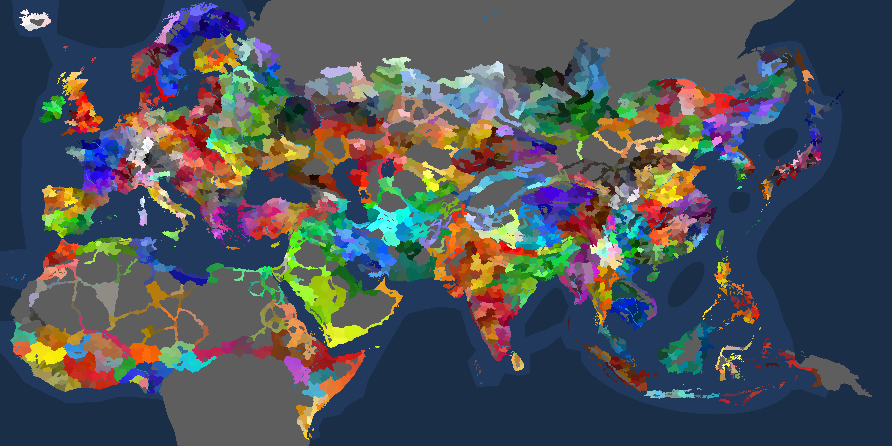
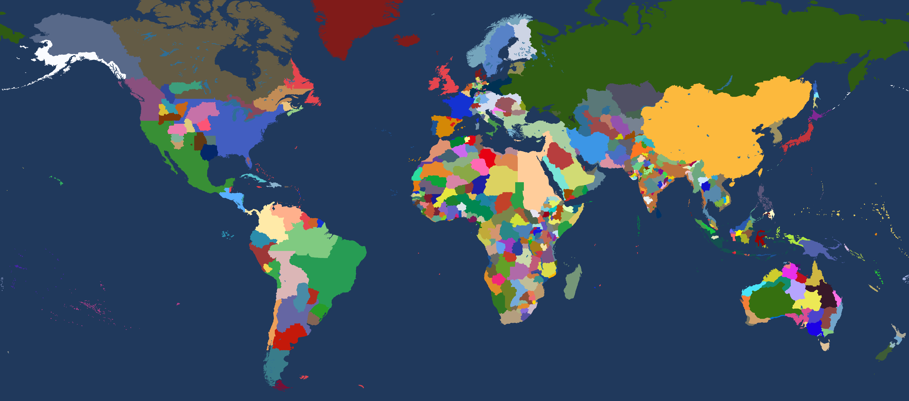

# 悖论制图

> **当前版本：v1.11.1 正式版（2026-11-05）**

> 作者：永夜廿九（B 站同名）· 代码以 MIT 协议发布 · [下载最新版本](https://github.com/Nianjiujiang/pdx-map-editor/releases)

在浏览器里直接修改 Paradox 游戏地图的工具：涂色、改色、改名、调整边界，导出 PNG 或涂色文件。

编辑器读取游戏自带的地图数据，把国家、省份、地名按剧本年份画成一张可交互的地图。单击地块即可改色，按住拖动可以连续涂出一片，右键取色，滚轮缩放。适合制作视频封面、绘制架空世界、给战报配图，也可以单纯查看某个年份的势力分布。

无需安装、无需登录。地图包导入后完全在本地运行，断网也能继续画。

## 它能做什么

- 收录 CK3、EU4、HOI4、VIC3、EU5 五款游戏的地图，按剧本年份显示势力版图，EU4 覆盖 1444 至 1792 共 12 个剧本。
- 涂色、填色、橡皮与改名四类编辑，按「颜色 + 标记」成组处理，一次点击可以改掉同一势力的整片版图。
- 颜色可用 HEX、RGB、调色板、最近使用与 ColorBrewer 色标选取，支持 24 色收藏。
- 边界按级别叠加，五档浓度可调；水域与荒地各有独立开关，互不影响。
- 地图图例直接绘制在地图上，可拖动、缩放、改版式，导出成品与屏幕预览一致。
- 导出当前窗口、整图或框选区域为 PNG，倍率 0.1 至 8 倍；涂色可存为 JSON 或存入浏览器地图仓库。





以上截图为编辑器内的实际画面，颜色与名称均为实时绘制。

## 快速开始

有两种用法，任选一种。

| 方式 | 适合 | 做法 |
|---|---|---|
| 单文件 | 只想使用 | 下载 `pdx-map-editor.html`，双击用浏览器打开 |
| 本地服务 | 改代码、自己构建 | 在项目目录运行 `python server.py`，打开 `http://127.0.0.1:8777/` |

单文件版不内嵌地图，第一次打开时在选图页点「⤓ 下载地图包」，或把 `.pdxmap` 拖进窗口。手机与平板使用同一 Release 中的 `pdx-map-editor-mobile.html`。

源码方式不能直接双击 `web/index.html`：浏览器在 `file://` 协议下读不到地图的二进制分块，页面无法正常加载。`python server.py` 会启动一个本地静态服务器并自动打开浏览器，端口可用 `--port` 指定，`--no-open` 表示不自动打开。

## 地图包

地图数据与编辑器分开发布。仓库里不存放 `.pdxmap` 文件，包作为 Release 附件提供，按需下载。

| 地图包 | 内容 | 大小 |
|---|---|---|
| `pdx-ck3-vanilla.pdxmap` | CK3 原版，1066 年 | 约 2.5 MB |
| `pdx-eu4-vanilla.pdxmap` | EU4 原版，1444 至 1792 | 约 0.9 MB |
| `pdx-hoi4-vanilla.pdxmap` | HOI4 原版，1936 / 1939 | 约 1.6 MB |
| `pdx-hoi4-alt.pdxmap` | HOI4 修改边界 | 约 1.6 MB |
| `pdx-vic3-vanilla.pdxmap` | Victoria 3，1836 年 | 约 3.8 MB |
| `pdx-eu5-vanilla.pdxmap` | EU5，1337 年 | 约 4.4 MB |
| `pdx-eu5-full.pdxmap` | EU5 原尺寸，地块更细 | 约 13.1 MB |

三种获取方式：

1. **在编辑器内下载。** 选图页点「⤓ 下载地图包」，列表来自 GitHub 最新 Release。点卡片会先尝试取回并直接导入，取不到时退回浏览器下载，把文件拖回该页即可。
2. **手动下载后导入。** 从 Release 附件下载 `.pdxmap`，按 `Esc` 回到选图页，点「＋ 导入地图包…」选择文件，或直接把文件拖进这一页。
3. **自己打包。** 地图作者可用 `python pack_map.py data_xxx --id my-map --label "我的地图" --out my-map.pdxmap` 生成包，玩家导入即可，不必等编辑器适配某个模组。

导入的地图保存在浏览器的 IndexedDB 中，刷新与重启都不会丢失；换电脑或清除浏览器数据后需要重新导入，因此请保留原始 `.pdxmap`。同一份包重复导入会新增一张地图，不会覆盖已有内容。卡片右下角提供导出与删除。

**国内网络。** 取包按以下顺序尝试：阿里云 OSS 镜像、Cloudflare Worker、三个公共 GitHub 加速站、直连。代理通道 6 秒超时，直连 20 秒；失败的通道在 5 分钟内不再重试。全部失败时退回浏览器下载，把下载好的文件拖回选图页同样可以导入。OSS 镜像与 Release 附件使用相同文件名，因此两边需要同步更新。

**全量单文件。** 需要把全部地图装进一个 HTML 时，运行 `python build_standalone.py --all-maps`，产物约 35 MB，双击即可使用，适合离线分发。

## 界面速览

| 区域 | 内容 |
|---|---|
| 顶栏 | 左侧为侧栏开关、标题、剧本下拉、视图层级与工具；工具右侧是教程与作者；右侧为撤销 / 重做、文件菜单与设置 |
| 左侧栏 | 显示开关、当前颜色、悬停地块、查找头衔 |
| 画布 | 查看工具或中键拖动平移，滚轮缩放，右下角有缩放按钮；涂抹与橡皮下拖动为连续涂色 |
| 底部状态栏 | 地图尺寸、指针位置、缩放倍率与本次改动数量 |

「显示」区分四组：地块、势力、水域、荒地。地块与势力控制各自的边界、名称与颜色，地块另有「父级边界」；水域只有边界与名称两个开关；荒地在此之外还有「自动上色」。水域与荒地默认关闭，需要时再打开。「清除全部」与「清除荒地」也在这里，清除全部可用 `Ctrl + Z` 撤销。

「当前颜色」显示画笔色与标记。点大色块会弹出二级菜单：自定义颜色、调色板、最近使用、色标。HEX、RGB 与标记文本框可直接输入；「取色后切到」决定吸管取色后自动切到涂抹还是填色。

「文件 ▾」菜单包含保存地图、导入涂色方案、导出涂色方案、导出窗口、导出整图与导出日志。设置面板分为颜色、边界线、名称、图例四页，顶部可切换昼夜主题。

窄屏下顶栏会多出一个「收起」按钮，折叠工具那一排；左侧栏可用顶栏最左的按钮或 `\` 键收起。按 `Esc` 返回选图页，编辑器会把当前涂色先存入暂存区。

## 常用操作

| 操作 | 做法 |
|---|---|
| 涂色 | 选「涂抹」（`E`，按住拖动连续涂）或「填色」（`F`，单击只处理一次），再选颜色 |
| 改色 | 按 `W` 或右键单击地块取色；也可直接输入 HEX / RGB，或从调色板、最近使用、色标中选 |
| 改名 | 按 `N`，单击地块后输入名称；只影响显示，不改动游戏文件 |
| 改边界 | 边界随涂色范围变化：切到更细层级涂抹或擦除即可改变轮廓；线宽与浓度在设置「边界线」中调整 |
| 图例 | 设置 → 图例，开启显示后可拖动位置、拖右下角缩放；条目按所绘颜色自动分组 |
| 导出 | 文件 → 导出窗口 / 导出整图；整图可选倍率或宽高，也可框选局部 |
| 保存 | 文件 → 保存地图，存入浏览器「地图仓库」；或导出涂色方案为 JSON |

涂色一次影响多少地块，取决于当前视图：

- 当前地块已有涂色时，全图中颜色与标记相同的地块视为一组，一起修改。
- 当前地块未涂色时，按剧本归属处理，只改该国范围内颜色与标记相同的部分。
- 两者都不成立时，只改最低单位对应的一块。
- 荒地始终只改自身；开启「荒地 · 自动上色」后，按周边陆地颜色的严格多数决定是否上色。

在非剧本视图下规则更简单：只修改当前层级对应的地块。省层单击只改该省，地区或州层单击会改其范围内的所有省。悬停高亮的范围与单击后修改的范围一致。

搜索框支持国家代码、国名、省名、地名与 `c_` / `d_` / `k_` / `e_` 前缀的 key。结果的色点可单击取色，地区与省份行可跳转，国家行不会移动视图。

## 快捷键

工具键与全局快捷键均以源码为准。输入框获得焦点时，除 `Esc` 外的快捷键不会触发。

| 操作 | 按键 |
|---|---|
| 查看 / 吸管 / 填色 | `Q` / `W` / `F` |
| 涂抹 / 橡皮 / 改名 | `E` / `R` / `N` |
| 旗帜工具 | `T` |
| 撤销 | `Ctrl + Z`（macOS 为 `⌘ + Z`） |
| 重做 | `Ctrl + Shift + Z` 或 `Ctrl + Y` |
| 切换地理层级 | `1` 至当前地图的地理层数，一般为 3 至 6 个，数字即层级序号 |
| 平移视角 | 方向键；按住 `Shift` 步子更大 |
| 收起 / 展开左侧栏 | `\` |
| 回到选图页 | `Esc` |
| 搜索：跳到第一条能定位的结果 | `Enter` |
| 图例获得焦点后微调 / 缩放 | 方向键 / `Shift` + 方向键 |
| 框选导出：确认 / 取消 / 微调 | `Enter` / `Esc` / 方向键 |

剧本层不占用数字键，通过顶栏的剧本下拉选择；剧本少于四个时下拉收起，剧本按钮直接排在层级那一行。工具栏上的数字与字母提示即对应按键。`Esc` 不区分焦点，输入框内按下同样会先暂存涂色再回到选图页。

## 系统要求

| 项目 | 要求 |
|---|---|
| 浏览器 | 近两年内的 Chrome、Edge、Firefox 或 Safari，需支持 WebGL2 并开启硬件加速 |
| 图形 | 集成显卡可以正常使用；EU5 原尺寸等大地图对显存要求更高 |
| 内存 | 整图导出按像素估算内存，默认上限 720 MB；设备内存 4 GB 以下降到 360 MB |
| 手机 | 使用手机版单文件，支持单指涂色与双指缩放；iOS 单个画布约 1600 万像素，大图建议导出当前画面 |

浏览器或显卡驱动关闭硬件加速、回退到软件渲染时，画布会明显变慢甚至无法创建 WebGL2 上下文。渲染失败时编辑器会给出说明卡，而不是停留在空白页。

## 常见问题

**打开后白屏或黑屏。** 先等半分钟。启动超过 25 秒没有进展时，页面会换成「没能启动」说明卡，列出卡住的步骤、浏览器信息与常见原因，并提供「复制诊断」与「导出诊断报告」。若卡片显示不支持 WebGL2，请开启硬件加速或换用 Chrome、Edge。

**提示图形上下文丢失。** 浏览器回收了 WebGL 上下文，常见于显存紧张、驱动重置或手机切到后台。编辑器会自动重建显卡资源并恢复画面；若页面要求刷新，先保存地图再刷新，涂色在切换回选图页时也会进入暂存区。

**确认是软件渲染。** 设置页与诊断报告都会标出渲染器名称。软件渲染下缩放与涂色极慢，请在浏览器设置中开启「使用硬件加速」，或更新显卡驱动。

**手机浏览器打不开或无法选图。** 请使用 `pdx-map-editor-mobile.html`，不要用桌面版。iOS 上系统选图依赖文件输入框仍在布局中，若点击无反应，升级 Safari 后重试。

**iPad / iPhone 上一直停在「正在准备…」。** 不要在「文件」App 的预览里直接打开 HTML，预览器不执行 JavaScript。点右上角分享 → 用 Safari 打开；或长按文件 → 共享 → Safari。安卓请在 Chrome 里打开。

**导入地图包没有反应。** 地图包只能在选图页导入：按 `Esc` 回到选图页，点「＋ 导入地图包…」，或把 `.pdxmap` 拖到该页。编辑器内部只接受涂色 JSON。若提示「这个包是旧版本做的」，说明包格式过旧，需要作者用新版 `pack_map.py` 重新导出。

**旧地图包还能用吗。** 能。编辑器向后兼容旧包，只是旧包里烘焙的默认视图与地图数据不会随编辑器更新。EU4 的大区海洋修复需要重新下载新版包；EU5 的湖泊修复由前端完成，旧包同样生效。

**涂色会自动保存吗。** 不会。刷新页面前请用「文件 → 保存地图」存入地图仓库，或「导出涂色方案」保存为 JSON。关闭页面时若有改动且尚未导出或存入地图仓库，浏览器会弹出确认。

**需要联网吗。** 导入地图包之后不需要。首次获取地图包、检查更新与打开作者主页需要网络。

## 开发与构建

```text
web/                编辑器本体，原生 JavaScript + WebGL2，无框架
  index.html        界面与设置面板
  js/app.js         主逻辑：状态、工具、搜索、导出
  js/gl.js          渲染器与着色器
  js/labels.js      地名与国名标注
  js/tilemap.js     分块地图加载
  js/pack.js        地图包校验
  js/packstore.js   IndexedDB：地图包与地图仓库
  js/log.js         诊断报告
parsers/            各游戏解析器
build_*.py          数据构建与单文件打包
pack_map.py         打包 .pdxmap
server.py           本地静态服务器
tools/              自检与性能工具
docs/               开发文档
```

| 目的 | 命令 |
|---|---|
| 启动本地服务 | `python server.py` |
| 解析游戏数据 | `python build_data.py`，EU4 / HOI4 / VIC3 / EU5 分别用 `build_eu4.py`、`build_hoi4.py`、`build_vic3.py`、`build_eu5.py` |
| 构建电脑版 | `python build_standalone.py`；加 `--all-maps` 出全量版 |
| 构建手机版 | `python mobile/build.py` |
| 打包全部地图 | `python build_packs.py` |
| 打包单张地图 | `python pack_map.py data_eu4 --id my-map --label "我的地图" --out my-map.pdxmap` |
| 行为测试 | `node tools/test_modes.js EU4`，CK3 / CK2 / EU4HD / HOI4 / VIC3 / EU5 同理 |
| 产物检查 | `node tools/check_standalone.js`、`check_mobile.js`、`check_import.js`、`check_pack.js`、`check_modules.js` |
| 性能红线 | `node tools/perf_baseline.js --check` |
| 注释修复 | `python tools/fix_comments.py --dry` |

`test_modes.js` 每个模式约 500 至 600 条断言，覆盖数据完整性、层级与标签缩放、显示开关、多级边界、名称归属与荒地自动上色。`check_standalone.js` 与 `check_mobile.js` 验证的是构建产物，修改源码后需要先重新构建再运行。

新增 JavaScript 文件时，需要同时登记到 `build_standalone.py` 的 `MODULES`、`tools/lib/browser_stub.js` 的 `MODULES` 与 `tools/test_modes.js` 自带的清单，三处必须一致。改动界面结构后，需要重新构建手机版并运行 `check_mobile_parity.js`；手机版由构建脚本把桌面节点搬进单文件，桌面结构的改动不会自动同步。

版本号写在 `web/index.html` 的 `<meta name="pdx-version">` 中，涨版本只改这一行。详细说明见 [`docs/构建与开发说明.md`](docs/构建与开发说明.md)。

## 许可与致谢

代码以 **MIT** 协议发布，详见 [`LICENSE`](LICENSE)。游戏地图数据的版权归 Paradox Interactive 所有，本项目不附带任何游戏原文件，只包含代码与自行解析出的地图缓存。随项目分发的第三方配色（ColorBrewer 2.0 / Apache-2.0，色表打包自 d3-scale-chromatic / ISC）的版权与许可全文见 [`THIRD-PARTY-NOTICES.md`](THIRD-PARTY-NOTICES.md)。

中文名称来源：CK3 使用游戏自带简体中文，EU4 使用汉化模组，`tools/extract_eu4_zh.py` 会从 workshop 的汉化模组中抽取，找不到时回退为英文名。感谢汉化组。色标配色方案来自 Cynthia Brewer 的 ColorBrewer 2.0，引用格式与许可全文同样写在 [`THIRD-PARTY-NOTICES.md`](THIRD-PARTY-NOTICES.md) 里。

问题反馈可提交 GitHub issue，或在 B 站评论区留言。附上截图与「导出日志」生成的诊断报告，定位会快很多。
